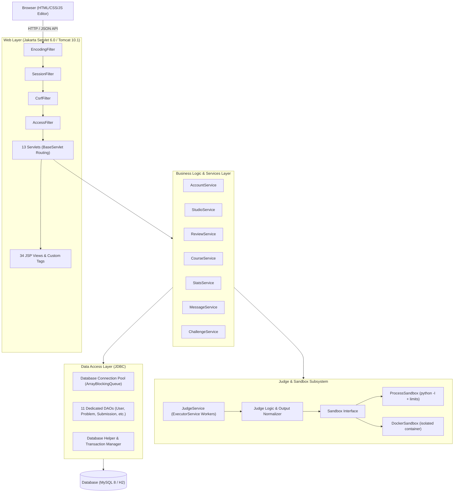

# 🐍 PyJudge: Python-Based Online Coding & Learning Platform

[](https://openjdk.org/projects/jdk/17/)
[](https://jakarta.ee/specifications/servlet/6.0/)
[](https://jakarta.ee/specifications/pages/3.1/)
[](https://tomcat.apache.org/)
[](https://www.python.org/)
[]()

> A full-featured online platform for learning Python through interactive coding exercises, tutorial courses, and competitive challenges. Built with pure **Core Java, JDBC, Jakarta Servlets 6.0, and JSP 3.1** (strictly no Spring, no ORM frameworks).
>
> Students write Python in the browser, run it with custom inputs, and submit it for instant automated evaluation against hidden test cases. Instructors create problems, curate course lessons, grade student solutions, and review performance reports. Administrators supervise users, approve new content, and configure site-wide operational limits.

---

## Table of Contents
- [1. Project Description & Objectives](#1-project-description--objectives)
- [2. System Requirements & Tech Stack](#2-system-requirements--tech-stack)
- [3. Architecture & Design Decisions](#3-architecture--design-decisions)
- [4. Academic Rubric & Core Java Concepts](#4-academic-rubric--core-java-concepts)
- [5. Features Walkthrough by Role](#5-features-walkthrough-by-role)
  - [Admin Features](#admin-role)
  - [Instructor & Studio Features](#instructor-role)
  - [Student Features](#student-role)
  - [Judging & Sandbox Engine](#judging--code-execution-engine)
- [6. Security Architecture](#6-security-architecture)
- [7. Quick Start & How to Run](#7-quick-start--how-to-run)
  - [Zero-Setup Mode (Embedded H2)](#option-a-zero-setup-mode-embedded-h2-database-recommended)
  - [Production Mode (MySQL 8)](#option-b-running-with-mysql-8)
  - [Pre-Seeded Demo Accounts](#pre-configured-demo-accounts)
- [8. Testing & Verification](#8-testing--verification)
- [9. Directory & Package Structure](#9-directory--package-structure)
- [10. Command Line Administration](#10-command-line-administration)

---

## 1. Project Description & Objectives

Learning programming is notoriously frustrating when students are bogged down by local environment setup, PATH misconfigurations, and compiler inconsistencies. Simultaneously, educators face enormous grading backlogs and lack automated, safe evaluation pipelines.

**PyJudge** provides a self-contained, browser-first platform where:
1. **Students** write Python in an interactive web editor, test their logic with custom inputs, receive instant verdicts against hidden test cases, earn achievements, and track progress along structured learning paths.
2. **Instructors** author rich coding problems with Markdown descriptions, set granular CPU/memory limits, add sample and hidden test cases, grade student submissions with rubric feedback, and communicate directly with learners.
3. **Administrators** control user accounts, moderate proposed instructor problems through an approval workflow, manage platform announcement banners, and toggle system limits.

---

## 2. System Requirements & Tech Stack

### System Prerequisites
| Requirement | Minimum Version | Description |
|---|---|---|
| **Java JDK** | 17 LTS+ | Core language platform (Amazon Corretto, Eclipse Temurin, or OpenJDK) |
| **Apache Maven** | 3.8+ | Build automation and dependency management |
| **Python** | 3.8+ (`python` / `python3`) | Used by the judge sandbox to evaluate submitted code |
| **Database** | H2 (embedded) or MySQL 8+ | H2 runs out of the box with zero installation; MySQL for production |
| **Web Browser** | Modern Browser | Chrome, Firefox, Edge, Safari (HTML5/CSS3/ES6) |
| **Docker** *(Optional)* | Docker 20.10+ | Required only if running production-grade isolated container sandboxes |

### Technology Stack
```
┌─────────────────────────────────────────────────────────────────┐
│ Browser / Presentation Layer: JSP 3.1, JSTL 3.0, Vanilla JS, CSS3│
├─────────────────────────────────────────────────────────────────┤
│ Web Application Layer: Jakarta Servlet 6.0, Tomcat 10.1         │
├─────────────────────────────────────────────────────────────────┤
│ Business Logic Layer: Service Layer, AppContext Dependency Graph │
├─────────────────────────────────────────────────────────────────┤
│ Persistence Layer: Plain JDBC, Connection Pool, PreparedStatement│
├─────────────────────────────────────────────────────────────────┤
│ Code Execution: ProcessSandbox (local) / DockerSandbox (prod)    │
├─────────────────────────────────────────────────────────────────┤
│ Storage: MySQL 8 (12 Normalized Tables) / H2 Embedded           │
└─────────────────────────────────────────────────────────────────┘
```

---

## 3. Architecture & Design Decisions

PyJudge adheres strictly to a **clean, layered 4-tier architecture** with clear separation of concerns:



### Architectural Highlights
- **No Heavy Frameworks**: Built using pure Core Java and Jakarta Servlets to keep execution lightweight, transparent, and compliant with academic specifications.
- **Asynchronous Non-Blocking Judging**: Judging runs on a background thread pool (`JudgeService` with `ExecutorService`). Submissions return immediately to the browser with a `PENDING` status while the client polls the JSON endpoint.
- **Template Method Sandboxing**: The `AbstractSandbox` encapsulates the execution lifecycle (temp folder creation, process execution, stream consumption, timeout enforcement, cleanup), delegating command assembly to `ProcessSandbox` or `DockerSandbox`.
- **Thread-Safe Singletons & Pure DI**: Dependencies are initialized once during startup in `AppContext` and passed via constructor injection.

---

## 4. Academic Rubric & Core Java Concepts

This project was built to address and exceed every criterion in strict software design rubrics:

| Rubric Focus Area | Implementation in PyJudge |
|---|---|
| **Object-Oriented Design** | Encapsulated domain models (`User`, `Problem`, `Submission`, `TestCase`, `Challenge`, `Lesson`). Domain business rules (e.g. `Problem.editableBy(user)`) reside with the domain entities. |
| **Inheritance & Polymorphism** | `BaseServlet` provides declarative URL routing for 13 servlets; `BaseDao` unifies parameter mapping for 11 DAOs; `AbstractSandbox` decouples execution logic from runtime environments. |
| **Generics & Collections** | Generic `Page<T>` pagination, `RowMapper<T>` functional mapping, `inTransaction(Supplier<T>)`. Extensive use of `Map`, `List`, `Set`, `TreeSet` (sorted tags), and `ArrayBlockingQueue` (pool). |
| **Multithreading & Concurrency** | `JudgeService` manages asynchronous worker threads via `ExecutorService`. The connection pool uses `BlockingQueue`, `AtomicInteger`, and `ThreadLocal` connection scoping. |
| **JDBC & Transactions** | 100% parameterised `PreparedStatement` usage (zero SQL injection vulnerabilities). Custom connection pool with thread-local atomic transactions (`Database.inTransaction`). Batch inserts (`addBatch`/`executeBatch`). |
| **Exception Handling** | Robust custom hierarchy (`DaoException`, `SandboxException`, `CurriculumException`, `HttpError`, `LoginRequired`) paired with consistent try-with-resources. |
| **I/O & Process Execution** | High-performance NIO (`java.nio.file`), `ProcessBuilder` with stream redirection, process tree destruction, and memory/time limit enforcement. |
| **Security Engineering** | Salted PBKDF2 with SHA-256 password hashing, cryptographically secure CSRF tokens on state-changing requests, XSS output sanitization, and strict Role-Based Access Control (RBAC). |

---

## 5. Features Walkthrough by Role

### 🛡️ Admin Role
Accessible at `/admin`:
- **User Management (`/admin/users`)**: Search, filter by role (Student, Instructor, Admin), create accounts, edit profile details, toggle active/blocked status, and safely delete accounts.
- **Content Moderation (`/admin/approvals`)**: Review submitted problems and lessons authored by instructors. Admins can view complete problem statements, starter templates, and test cases, then approve or reject with mandatory reviewer notes.
- **Content Management (`/admin/content`)**: Global inventory of all problems in the system with bulk filtering and direct editing capability.
- **System Settings (`/admin/settings`)**: Live control over platform name, announcement banner, open registration toggle, mandatory approval toggle, messaging permissions, and default execution timeouts.
- **Analytics Dashboard (`/admin`)**: Real-time KPI cards (users, problems, submissions), submissions-per-day trend graphs, active student charts, and recent activity logs.

### 👨‍🏫 Instructor Role
Accessible at `/instructor` and `/studio`:
- **Exercise Studio (`/studio/exercises/new`)**: Markdown-supported problem editor, time/memory limit controls, tags, starter code templates, sample test cases (visible to students), and hidden test cases (for grading).
- **Curriculum Authoring (`/instructor/lessons`)**: Create and organize custom tutorial lessons with runnable interactive Python snippets and multiple-choice quizzes.
- **Grading Queue (`/instructor/submissions`)**: Dedicated queue of submissions awaiting manual review. Reviewers assign numeric scores (0–100), write feedback, and click *"Save & Grade Next"* for streamlined workflow.
- **Student Messaging (`/messages`)**: Threaded messaging system allowing instructors to provide guidance or respond to *"Ask an instructor"* submission queries.
- **Performance Reports (`/instructor/reports`)**: Acceptance-rate distributions, per-exercise difficulty metrics, and per-student completion analytics.

### 🎓 Student Role
Accessible at `/student` and `/problems`:
- **Interactive Coding (`/problems/{slug}`)**:
  - Full-screen split-pane code editor.
  - **Run Code**: Execute Python snippets against custom standard input.
  - **Submit Code**: Run against hidden test suites with animated real-time verdict reporting.
- **Structured Learning Course (`/learn`)**:
  - 11 comprehensive Python topics comprising 32 lessons (from basic syntax to algorithms).
  - In-browser runnable code demos and interactive comprehension quizzes.
- **Competitive Challenges (`/challenges`)**:
  - Time-boxed coding sprints with live leaderboards and automated completion scoring.
- **Gamified Progress Tracking (`/student`)**:
  - Solved problems by difficulty breakdown (Easy, Medium, Hard).
  - Day streak counter, global points, ranking, and achievement badges.
- **Community & Leaderboard (`/leaderboard`)**:
  - Global student rankings based on difficulty-weighted problem completions.

### ⚖️ Judging & Code Execution Engine
PyJudge uses an automated evaluation pipeline yielding standardized verdicts:

| Verdict | Meaning | Description |
|---|---|---|
| **AC** | Accepted | Code executed cleanly and passed all test cases within limits. |
| **WA** | Wrong Answer | Program finished cleanly, but stdout did not match expected output. |
| **TLE** | Time Limit Exceeded | Execution exceeded configured timeout (e.g. infinite loop). |
| **MLE** | Memory Limit Exceeded | Program exceeded allocated RAM limit. |
| **RE** | Runtime Error | Script crashed with an unhandled exception or nonzero exit code. |
| **CE** | Compilation / Syntax Error | Python syntax checker (`compile()`) failed before execution. |
| **IE** | Internal Error | Infrastructure or sandbox failure. |

> **Line Ending & Whitespace Normalization**: The judge engine normalizes trailing whitespace and CRLF/LF line endings, ensuring students aren't penalized for OS-specific formatting.

---

## 6. Security Architecture

- **Code Isolation**:
  - **Process Sandbox**: Executes `python -I` (isolated mode, ignoring `PYTHON*` environment variables and user site-packages) inside a throwaway temporary directory with stripped environment variables.
  - **Docker Sandbox**: Spins up a locked-down, single-use container (`--network=none`, `--read-only`, dropped root capabilities, non-root user).
- **Authentication & Password Storage**: Salted PBKDF2 (Password-Based Key Derivation Function 2) using `PBKDF2WithHmacSHA256` with 310,000 iterations and 16-byte random salts.
- **CSRF Defense**: Nonce tokens generated via `SecureRandom` stored in session and strictly verified on every POST/PUT/DELETE request by `CsrfFilter`.
- **SQL Injection Prevention**: 100% of database interactions utilize parameterized `PreparedStatement` objects.
- **XSS Mitigation**: JSP views use standard JSTL `c:out` and `fn:escapeXml`. The CommonMark Markdown renderer explicitly has HTML parsing disabled (`html(false)`).
- **RBAC Enforcement**: The `AccessFilter` intercepts and verifies role permissions before requests reach servlet handlers.

---

## 7. Quick Start & How to Run

### Option A: Zero-Setup Mode (Embedded H2 Database) — *Recommended*
PyJudge includes built-in embedded H2 database support with MySQL compatibility mode. **No database server needs to be installed.**

1. **Verify Prerequisites**:
   Make sure `java` (17+), `mvn`, and `python` are in your PATH:
   ```bash
   java -version
   mvn -v
   python --version
   ```

2. **Build and Run**:
   From the project root directory, run:
   ```bash
   # Windows (PowerShell / Command Prompt)
   mvn package cargo:run

   # Linux / macOS
   mvn package cargo:run
   ```
   *Cargo will automatically download Apache Tomcat 10.1, deploy `pyjudge.war`, and launch the web server on port 8080.*

3. **Access the App**:
   Open **[http://localhost:8080/pyjudge](http://localhost:8080/pyjudge)** in your browser!

---

### Option B: Running with MySQL 8

To connect PyJudge to a production MySQL 8 instance:

1. Create a MySQL database and user:
   ```sql
   CREATE DATABASE pyjudge CHARACTER SET utf8mb4 COLLATE utf8mb4_unicode_ci;
   ```
2. Update `src/main/resources/application.properties` (or pass environment variables):
   ```properties
   db.url=jdbc:mysql://localhost:3306/pyjudge?createDatabaseIfNotExist=true&useUnicode=true&characterEncoding=UTF-8&connectionTimeZone=UTC&allowPublicKeyRetrieval=true&useSSL=false
   db.user=your_mysql_user
   db.password=your_mysql_password
   ```
   *(Or launch without modifying files using `set PYJUDGE_DB_URL=...` and `set PYJUDGE_DB_USER=...`)*.
3. Start the application:
   ```bash
   mvn package cargo:run
   ```

---

### Pre-Configured Demo Accounts

On the very first launch, PyJudge automatically seeds the database with 37 coding problems, 32 course lessons, and 3 starter accounts:

| Role | Username | Password | Purpose |
|---|---|---|---|
| **Admin** | `admin` | `admin12345` | Manage users, approve exercises, edit system settings |
| **Instructor** | `instructor` | `instructor12345` | Create problems & lessons, review & grade student code |
| **Student** | `student` | `student12345` | Solve problems, complete course lessons, join challenges |

*(You can also register a brand-new student account directly via the **Sign up** button).*

---

## 8. Testing & Verification

PyJudge comes with an extensive automated test suite covering all layers of the application:

```bash
mvn test
```

### Test Suites Included:
- **`JudgeTest`**: Validates sandbox execution, timeout detection (TLE), memory limit detection (MLE), runtime errors (RE), output truncation, unicode input/output, and test isolation.
- **`CourseTest`**: Verifies that all 32 tutorial Markdown lessons parse correctly and that every single embedded Python code example executes without errors.
- **`WorkflowTest`**: Tests end-to-end multi-role workflows: user creation, approval lifecycle, grading queue, messaging, challenges, and cascading deletes.
- **`SeedTest`**: Ensures standard starter content is completely valid, repeatable, and that all reference solutions achieve an `AC` verdict.

---

## 9. Directory & Package Structure

```
pyjudge/
├── pom.xml                               # Maven project configuration
├── README.md                             # Comprehensive project documentation
├── docs/
│   └── DESIGN.md                         # Detailed design, rubric mapping & specification
├── docker/
│   └── Dockerfile                        # Production Docker sandbox container image
├── src/
│   ├── main/
│   │   ├── java/com/pyjudge/
│   │   │   ├── AppContext.java           # Dependency injection wiring container
│   │   │   ├── config/AppConfig.java     # Hierarchical configuration loader
│   │   │   ├── curriculum/               # Markdown course parser and synchronizer
│   │   │   ├── dao/                      # 11 JDBC Data Access Objects
│   │   │   ├── db/                       # Connection pool, transactions, schema initializer
│   │   │   ├── judge/                    # Sandboxes (Process & Docker), Judge, JudgeService
│   │   │   ├── model/                    # Domain models, records, and enums
│   │   │   ├── seed/                     # Seed loader for starter exercises and users
│   │   │   ├── service/                  # Business services (Accounts, Reviews, Stats, etc.)
│   │   │   ├── tools/AdminCli.java       # CLI administrative tool
│   │   │   └── web/                      # BaseServlet, Ctx, security filters, AppListener
│   │   │       └── servlet/              # 13 Jakarta HTTP servlets
│   │   ├── resources/
│   │   │   ├── application.properties    # Core configuration file
│   │   │   ├── schema.sql                # Complete 12-table DDL schema
│   │   │   ├── curriculum/               # 32 Markdown lesson files with embedded quizzes
│   │   │   └── seed/                     # 37 starter problems with sample & hidden test cases
│   │   └── webapp/
│   │       ├── WEB-INF/
│   │       │   ├── web.xml               # Deployment descriptor (filters, error pages, cookies)
│   │       │   ├── pyjudge.tld           # Custom JSP tag library functions
│   │       │   ├── tags/                 # Reusable JSP custom tag files (layout, badges, etc.)
│   │       │   └── views/                # 34 JSP presentation templates grouped by role
│   │       └── static/                   # Frontend assets (CSS styles, animations, JS editor)
│   └── test/
│       └── java/com/pyjudge/             # Unit and integration test suites
```

---

## 10. Command Line Administration

PyJudge includes a CLI tool for system maintenance and headless operations:

```bash
# Compile the project
mvn compile

# Change a user's role: student | instructor | admin
mvn -q compile exec:java -Dexec.args="set-role alice instructor"

# Reset a user's password
mvn -q compile exec:java -Dexec.args="set-password alice newpassword123"

# Force re-seeding of the starter exercises and course
mvn -q compile exec:java -Dexec.args="seed"
```

---

## 📄 License
This project is open-source educational software distributed under the MIT License.
